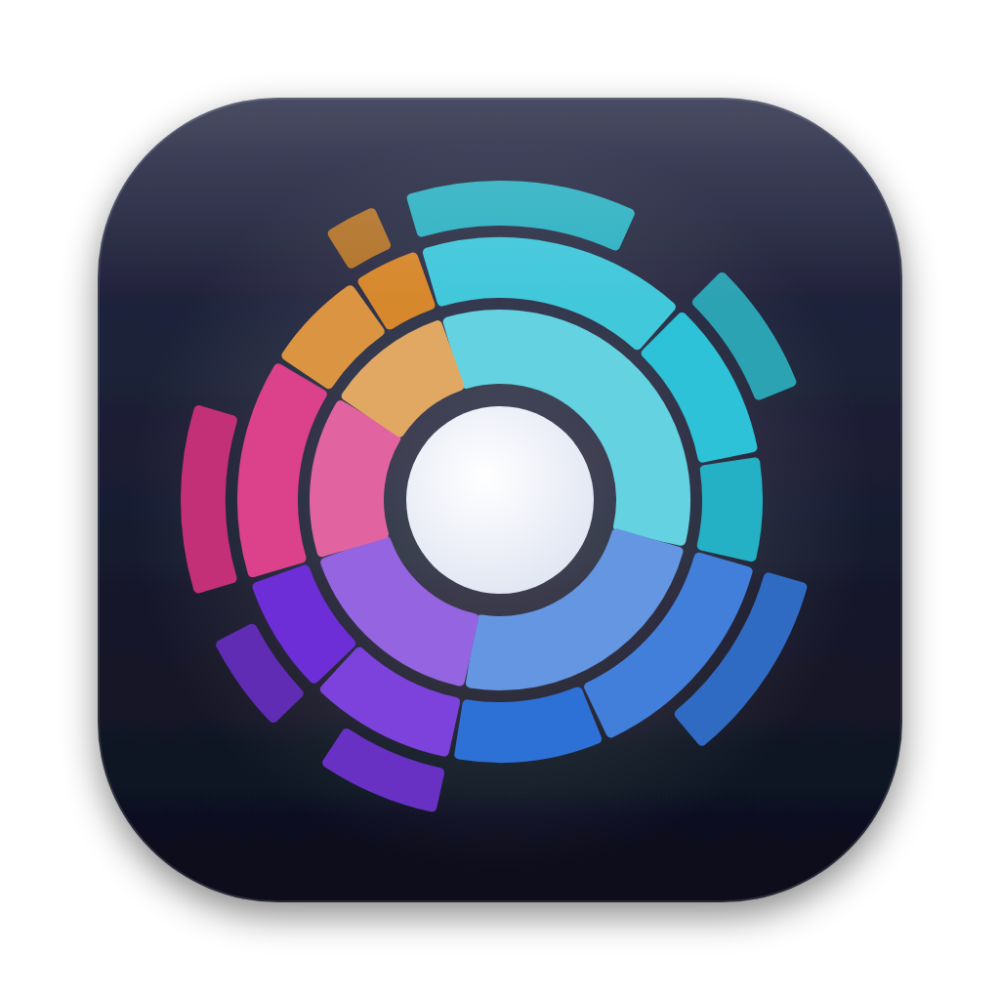

<p align="center"></p>

<h1 align="center">Diskbloom</h1>

<p align="center"><b>See what's eating your Mac's disk, then clean it up.</b><br>
Interactive sunburst map · Trash list · Smart Clean for developer junk<br>
Rust scanning engine, native SwiftUI app · English and Serbian</p>

> Status: early version (v0.3). Expect rough edges.

## Features

- **Fast parallel scanner** that measures real (allocated) size, counts hard links once and never follows symlinks.
- **Sunburst map**: rings are depth, angle is size. Click to zoom in, click the center to go back.
- **Trash list**: queue items while browsing, see the total, move everything to the Trash in one step.
- **Smart Clean**: build folders, package and app caches, Xcode data, simulators, emulators, VMs, old installers.
- **Largest files** with when you last opened them, and **duplicates** (size → partial hash → full BLAKE3 hash).
- **File types**: how much is video, images, audio, archives, documents, code, apps and system files, with the largest of each.
- **Search** the scan by name (ignoring case and diacritics); a folder result opens on the map.
- **Opens instantly**: the last scan is shown right away, then only folders that changed since are rescanned, with a list of **what grew**.
- **Forgotten projects**: build folders and dependencies of projects you haven't touched for 6 months.
- **Disk overview** with used / purgeable / free space and **Time Machine local snapshots**.
- **Menu bar item** with the startup disk's free space, every disk at a glance and shortcuts to Scan Home and Smart Clean; a **notification** when the startup disk runs low. Both can be turned off in Settings (⌘,).
- **Quick Look** (Space), **refresh one folder** (⌘R), views on ⌘1 / ⌘2 / ⌘3 / ⌘4, Smart Clean on ⌘K.
- **CLI** (`bloom`) for the terminal, also on Linux.

<details>
<summary><b>More about the features</b></summary>

- **Disk overview**: click a disk to see used / purgeable / free space and pick an action:
  scan, Smart Clean, scan only Home, empty Trash, open Storage settings, reveal, eject.
- **Scanner**: measures *allocated* size (`st_blocks`) rather than logical length and stays
  on one volume.
- **Map**: tiny items are merged into "smaller objects". Every item shows its share of the
  parent folder and of the disk.
- **Trash list**: click the trash icon on any row, or drag the row to the tray. The map dims
  queued items and updates in place, with no rescan.
- **Smart Clean** rules are context-aware: `target/` is only flagged next to a `Cargo.toml`.
  Regenerable items are preselected; emulators, VMs and backups are only listed for review.
  See [clean categories](#clean-categories).
- **Proper cleanup for developer tools**: iOS simulators and simulator runtimes are
  removed with `xcrun simctl`, Android emulators together with their `.ini`, and the
  Docker disk is never deleted; Diskbloom offers `docker system prune` instead.
- **Largest files**: the 300 biggest files, filterable to "not opened in 6 months / a year".
- **Duplicates**: "Keep one" queues the other copies for the Trash. Sizes account for APFS
  clones (copies that already share space are not counted), and **Replace with clones**
  frees the space while keeping every copy, after a byte-by-byte check.
- **Time Machine snapshots** are often the biggest part of "purgeable" space. Removing them
  asks for your admin password.
- **Menu bar**: free space counts purgeable space, like Finder, and refreshes every minute
  and when a disk is mounted or ejected. Click a disk to open its overview. Hide the item
  in **Settings** (⌘,) or by ⌘-dragging it out of the menu bar; the app keeps running.
- **Low-space notification**: once when the startup disk has less than 10% or 20 GB free
  (whichever is smaller), and again only after space has recovered a bit above that.
  macOS asks for permission the first time; clicking it opens the disk overview.
- **Hidden space**: the difference between what the volume reports as used and what the
  scan could see (system volume, snapshots, folders without permission).

</details>

## Install

**Download:** get the latest **Diskbloom-x.y.z.dmg** from
[Releases](https://github.com/NNikolaG/diskbloom/releases/latest) (Apple Silicon, macOS 13+)
and drag **Diskbloom** to **Applications**. The app is not notarized, so the first time
right-click it → **Open** → **Open**, or run:

```bash
xattr -dr com.apple.quarantine /Applications/Diskbloom.app
```

**Homebrew:** this repository is its own tap.

```bash
brew tap nnikolag/diskbloom https://github.com/NNikolaG/diskbloom
brew install --cask nnikolag/diskbloom/diskbloom
```

Then give it **Full Disk Access** (see below) so it can see the whole disk.

<details>
<summary><b>More about the Homebrew cask</b></summary>

- The full name `nnikolag/diskbloom/diskbloom` matters: Homebrew 6 and newer only load
  casks from taps you trust, and installing by full name trusts this one cask. To use the
  short name, run `brew trust --cask nnikolag/diskbloom/diskbloom` first.
- The app is not notarized, so the cask removes the `com.apple.quarantine` flag before it
  moves Diskbloom to Applications. That is what the manual `xattr` command above does too;
  only install it if you trust this repository's release builds.
- The cask lives in [`Casks/diskbloom.rb`](Casks/diskbloom.rb). The release workflow
  updates its version and SHA-256 after each release.
- `brew uninstall --cask diskbloom` removes the app; add `--zap` to also remove the
  preferences and saved window state macOS keeps for it.

</details>

<details>
<summary><b>Build from source</b> (Intel Macs, or the latest code)</summary>

Requirements: macOS 13 Ventura or newer, Apple Silicon or Intel.

1. Xcode Command Line Tools (full Xcode is not needed):
   ```bash
   xcode-select --install
   ```
2. Rust, with rustup (recommended, also allows universal builds):
   ```bash
   curl --proto '=https' --tlsv1.2 -sSf https://sh.rustup.rs | sh
   ```
   or with Homebrew: `brew install rust`. Open a new terminal afterwards.
3. Build and install into `/Applications`:
   ```bash
   git clone https://github.com/NNikolaG/diskbloom.git
   cd diskbloom
   ./macos/build.sh --install
   open -a Diskbloom
   ```

| Command | What it does |
|---|---|
| `./macos/build.sh` | builds `macos/build/Diskbloom.app` for this Mac |
| `./macos/build.sh --install` | builds and replaces `/Applications/Diskbloom.app` (quits the running app first, leaves no second copy in `macos/build`) |
| `./macos/build.sh --universal` | arm64 + x86_64 in one app (needs rustup) |

</details>

<details>
<summary><b>Updating</b></summary>

With Homebrew:

```bash
brew upgrade --cask diskbloom
```

With a release: download the new DMG and drag Diskbloom to Applications again; macOS asks
to replace the old version. From source, you never need to delete the old version by hand:

```bash
cd diskbloom
git pull
./macos/build.sh --install
```

</details>

<details>
<summary><b>Full Disk Access</b></summary>

Without it macOS hides parts of your disk (Mail, Messages, Safari data, other users, some
caches), and Diskbloom shows a yellow banner with the number of folders it could not read.

1. Open **System Settings → Privacy & Security → Full Disk Access** (the banner and the
   disk overview have a button for this).
2. Turn on **Diskbloom** (use **+** to add it from Applications if it's missing).
3. Quit and reopen Diskbloom.

**If it asks again after every build:** an app built without an Apple certificate gets a
new ad-hoc signature each time, and macOS treats every build as a different app. Add your
Apple ID once in **Xcode → Settings → Accounts** (a free account is enough); `build.sh`
then signs with the "Apple Development" certificate automatically. To pick a certificate:

```bash
DISKBLOOM_SIGN_IDENTITY="Apple Development: you@example.com (TEAMID)" ./macos/build.sh --install
```

</details>

<details>
<summary><b>Troubleshooting</b></summary>

| Problem | Fix |
|---|---|
| `rustup: command not found` / `cargo: command not found` | Install Rust (build step 2) and open a new terminal. |
| `xcrun: error: invalid active developer path` | Run `xcode-select --install`. |
| "Diskbloom can't be opened because Apple cannot check it" | Right-click → **Open**, or remove the quarantine flag (see Install). |
| Scanning **Macintosh HD** shows less than Finder | Grant Full Disk Access. The rest is system data and snapshots, shown as *hidden space*. |
| Emptying the Trash asks to control Finder | Expected: Diskbloom empties the Trash through Finder, so allow it once. |

</details>

<details>
<summary><b>Uninstall</b></summary>

```bash
rm -rf /Applications/Diskbloom.app
```

Installed with Homebrew: `brew uninstall --cask diskbloom`.

Diskbloom keeps two settings (menu bar item, low-space notification) and its saved scans
(file names and sizes only). Remove them with:

```bash
defaults delete io.github.nnikolag.diskbloom
rm -rf ~/Library/Caches/io.github.nnikolag.diskbloom
```

</details>

## Command line

<details>
<summary><b><code>bloom</code>: tree, HTML map and cleaner in the terminal</b></summary>

```bash
cargo install --path crates/cli

bloom top ~ -d 2 -n 10                 # biggest folders as a tree
bloom map ~ -o map.html                # interactive sunburst in one HTML file
bloom clean ~/code                     # dry run: what could be removed
bloom clean ~/code --delete -c rust-build,node-deps --min-mb 50
```

`bloom clean` only lists *safe* categories unless you add `--include-review` or name a
category with `-c`.

</details>

## Clean categories

<details>
<summary><b>What Smart Clean looks for, and what it never touches</b></summary>

**Safe** categories regenerate on their own and are preselected. **Review** categories
(emulators, VMs, simulator runtimes, Node versions, backups, installers) are listed but
never preselected.

Project rules (`node_modules`, `target/`, `build/`, `.venv`…) only apply to your own
projects. They never apply inside `node_modules` itself, inside `.app` bundles, in
`~/Library`, in system folders (`/usr`, `/opt/homebrew`, `/Applications`, …) or in tool
folders such as `~/.nvm`, `~/.volta`, `~/.fnm`, `~/.bun`, `~/.config/yarn`, `~/.vscode`,
`~/.cursor`, `~/.cargo` and `~/.rustup`. Global npm/pnpm/yarn/bun packages and editor
extensions are therefore never offered for removal.

| Category | Matches | |
|---|---|---|
| `rust-build` | `target/` next to `Cargo.toml` | safe |
| `node-deps` | `node_modules/` next to `package.json` | safe |
| `js-build` | `.next/`, `.nuxt/`, `.turbo/` next to `package.json` | safe |
| `python-cache` | `__pycache__/`, `.pytest_cache/`, `.mypy_cache/`, `.ruff_cache/` | safe |
| `python-venv` | any folder containing `pyvenv.cfg` | review |
| `gradle` | `.gradle/`, and `build/` next to `build.gradle(.kts)` | safe |
| `cocoapods` / `swift-build` | `Pods/` next to `Podfile`, `.build/` next to `Package.swift` | safe |
| `xcode-derived` | Xcode DerivedData, `~/Library/Caches/com.apple.dt.Xcode` | safe |
| `xcode-device-support` | each iOS / watchOS / tvOS / visionOS DeviceSupport version | safe |
| `xcode-archives` | each folder in Xcode Archives | review |
| `simulators` | each iOS simulator device in `CoreSimulator/Devices` | review |
| `simulator-cache` | `CoreSimulator/Caches` | safe |
| `sim-runtimes` | each simulator runtime image Xcode 15+ downloaded to `/Library/Developer/CoreSimulator` (`Images/*.dmg`, `Cryptex/Images/bundle/SimRuntimeBundle-*`); removed with `xcrun simctl runtime delete` | review |
| `android-emulators` | each `~/.android/avd/*.avd` | review |
| `android-images` | each Android SDK system image | review |
| `vms` | Docker Desktop disk, UTM, Parallels and VMware VMs | review |
| `pkg-cache` | Homebrew, pip, Yarn, pnpm, CocoaPods, npm, Cargo, Gradle, Maven, Go, NuGet, Bun caches | safe |
| `node-versions` | each Node version installed by nvm (`~/.nvm/versions/node/v*`), with its global packages | review |
| `jetbrains-cache` | each IDE version in `~/Library/Caches/JetBrains` and `~/Library/Logs/JetBrains` | safe |
| `editor-cache` | VS Code and Cursor `Cache`, `CachedData`, `Code Cache`, `GPUCache`, `logs` (and VS Code's `CachedExtensionVSIXs`) in `~/Library/Application Support`; never extensions, `User` settings or `workspaceStorage` | safe |
| `app-cache` | each folder in `~/Library/Caches`, and `~/.cache` | safe |
| `logs` | each item in `~/Library/Logs` | safe |
| `ios-backups` | each iPhone/iPad backup in MobileSync | review |
| `installers` | `.dmg`, `.pkg`, `.iso`, `.xip` in `~/Downloads` | review |
| `trash` | `~/.Trash`, `~/.local/share/Trash` | review |

</details>

## Development

<details>
<summary><b>Project layout, language, releasing</b></summary>

```
crates/core   scanner, arena tree, sunburst layout, clean rules, duplicate finder
crates/cli    `bloom` command line tool
crates/ffi    UniFFI bindings exposing the core to Swift
macos/        SwiftUI app (Swift Package) + build.sh
docs/         architecture notes
```

- **How it works:** [docs/ARCHITECTURE.md](docs/ARCHITECTURE.md)
- **Checks and code style:** [CONTRIBUTING.md](CONTRIBUTING.md)
- **Security model and review:** [SECURITY.md](SECURITY.md)

**Language.** The interface follows the macOS language setting: English by default,
Serbian (Latin) when Serbian is first in **System Settings → General → Language & Region**.
Translations live in `macos/Resources/<lang>.lproj/Localizable.strings`; the keys are the
English texts, so adding a language means copying `sr.lproj` and translating the
right-hand side.

**Releasing.** Push a tag and GitHub Actions builds an Apple Silicon DMG and publishes the
release (free for public repositories):

```bash
git tag v0.3.0 && git push origin v0.3.0
```

The same workflow then commits the new version and SHA-256 to `Casks/diskbloom.rb` on
`main`, so `brew upgrade` picks up the release.

</details>

## License

MIT.
